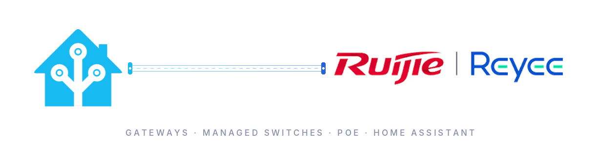

<p align="center">
  
</p>

# 🌐 Ruijie Reyee (Local) for Home Assistant

<p align="center">

**Complete local control for Ruijie Reyee EG Series Gateways, managed switches and PoE switches**

No cloud • No subscriptions • Direct LAN communication

[]()
[]()
[](https://github.com/hacs/integration)
[]()

</p>

---

## ✨ Overview

Ruijie Reyee (Local) is a **fully local** Home Assistant integration for
**Reyee EG-series gateways**, **NBS managed switches** and **ES-series PoE switches**.

Unlike the official cloud integration, this connects **directly to your
gateway** using the built-in eWeb API over your LAN.

✔ No Cloud Account

✔ No Internet Required

✔ Real-time Monitoring

✔ Full Network Control

✔ Automatic Discovery

✔ Switches & PoE Control

---

# 🚀 Features

## 📊 Network Monitoring

- 👥 Connected device list with friendly names
- 📍 Device Trackers for every client
- 🌐 VLAN discovery with named networks
- 🔌 Live Ethernet port status
- 📶 WAN upload/download throughput
- 🌍 Public IP monitoring
- 🔄 PPPoE reconnect tracking
- 📡 Connected APs and switches
- 📶 WiFi SSID monitoring
- 🔐 VPN client status
- 🔀 Active WAN detection
- 🌐 Port forwarding list
- 🏷 Device names from the router's saved device list
- 🔐 OpenVPN / L2TP / PPTP server status

---

## 🎛 Control

Control almost everything directly from Home Assistant.

| Feature | Supported |
|----------|-----------|
| 🌐 Primary WAN Switching | ✅ |
| 🔄 Forced WAN Failover | ✅ |
| 📶 WiFi SSID Enable/Disable | ✅ |
| 🚦 Flow Control | ✅ |
| ⚡ WiFi Rate Limiting | ✅ |
| 💡 Gateway LEDs | ✅ |
| 💡 AP LEDs | ✅ |
| 🚫 Block Internet Access | ✅ |
| 🌍 Port Forward Management | ✅ |
| ⚡ Hardware NAT | ✅ |
| ☎ SIP ALG | ✅ |
| 📺 IGMP Proxy | ✅ |
| 🔗 WAN Link Detection | ✅ |
| 📶 WiFi Load Balancing | ✅ |

---

## ⚙ Buttons

- 🔄 Refresh Router
- 🔍 Deep API Probe
- 📡 Scan Access Points (read-only, writes `/config/reyee_aps.json`)

---

# 🔀 Switches

Switches live **inside your router entry**, in their own **Switches** group:

```
Settings
→ Devices & Services
→ Ruijie Reyee (Local)
→ + Add switch (on the router entry)
→ pick the switch from the list (or type its IP)
```

The list shows the switches your router has already found. ES PoE switches
need no password (they're managed through the router); for NBS switches leave
the password empty to use the router's.

The integration page is split into folding groups:

| Group | What's in it |
|-------|--------------|
| 🌐 **Router** | the gateway and all its controls |
| 🔀 **Switches** | every switch, each one clickable to its own ports / PoE / VLAN page |
| 📶 **Access Points** | the APs the router sees |
| 📱 **Connected Devices** | every tracked client |

To remove a switch, open the **Switches** group's ⋮ menu → **Reconfigure** and
tick it. Typing a switch IP into **Add Integration** also works: it's put into
the router's Switches group instead of becoming a separate hub.

> **Upgrading from v1.24 or older?** Switches you added as their own hub are
> moved into the router's Switches group automatically on the first restart,
> keeping the same entity IDs. Nothing to delete or re-add.

Switches are read directly when they answer, otherwise **through the router**
(the same way the Reyee web interface manages them).

## 🖧 NBS Managed Switches

| Per port | |
|----------|---|
| 🔌 Link up/down (speed, VLANs, traffic, errors, connected devices) | ✅ |
| ⏻ Port enable / disable | ✅ |
| 🏷 VLAN (access VLAN / trunk native VLAN) | ✅ |
| 📝 Description | ✅ |
| 🛡 Port isolation | ✅ |
| 📈 RX / TX rate, link speed, CRC errors | ✅ |

| Switch-wide | |
|-------------|---|
| 🔁 Loop Detection | ✅ |
| 🌳 Spanning Tree | ✅ |
| 🔗 LLDP | ✅ |
| 🛡 DHCP Snooping | ✅ |
| 📺 IGMP Snooping | ✅ |
| ☎ Voice VLAN | ✅ |
| 🗂 VLAN list, create / delete VLANs | ✅ |
| ⚠ Loop detected, CRC errors, ports up, uplink port | ✅ |
| 🔄 Reboot | ✅ |

## ⚡ ES-Series PoE Switches

ES switches have no web login of their own. They are managed **through the
router**, so they can be added even though a direct login to them fails.

| Per port | |
|----------|---|
| 🔌 Link up/down (speed, VLAN, traffic, errors, loop, connected devices) | ✅ |
| ⚡ PoE on / off | ✅ |
| 🔁 PoE power-cycle (reboot a camera or AP) | ✅ |
| 🔋 PoE power (W), voltage, current, fault | ✅ |
| 🏷 VLAN and VLAN mode (access / trunk) | ✅ |
| 📈 RX / TX rate | ✅ |

| Switch-wide | |
|-------------|---|
| 🔋 PoE Power Used / Budget / Remaining (W) | ✅ |
| ⬆ Uplink port detection | ✅ |
| 🗂 VLAN list (creates a VLAN on the switch when needed) | ✅ |
| ⚠ Loop detected | ✅ |
| 🔄 Reboot | ✅ |

## 🛡 Safety

- The **uplink port** of a switch can't be disabled and its VLAN can't be changed
  — doing so would cut the switch off from the router.
- Every change uses the exact request the Reyee web interface sends. If a device
  rejects a change you get an error and nothing changes.

---

# 📶 Access Points

Add APs the same way, with **+ Add AP** on the router entry. Tick the APs from
the list the router has found; no password is needed (they're read through the
router). Each AP's device page in the **Access Points** group then gets:

| Sensor | |
|---|---|
| 👥 Clients (total, plus per 2.4G / 5G), with the client list as an attribute | ✅ |
| 📡 Channel per radio (frequency and bandwidth as attributes) | ✅ |
| 📊 Channel Busy % per radio | ✅ |
| 📶 Weakest Client Signal (dBm, and which client) | ✅ |
| ⬆⬇ Data Sent / Data Received | ✅ |
| 🔌 Uplink Speed, TX Power, Noise Floor, Firmware (diagnostic) | ✅ |

To remove an AP, open the **Access Points** group's ⋮ menu → **Reconfigure**.
Tested on RAP2200(E).

# 🖥 Supported Hardware

## Tested Hardware

- ✅ EG105G-V3 (ReyeeOS 2.360.x)
- ✅ RG-EW3000GX
- ✅ NBS3100-24GT4SFP-V2 (ReyeeOS 2.380)
- ✅ RG-ES220GS-P / RG-ES205GC-P (ESW_1.0)
- ✅ RG-ES210GS-P / RG-ES208GC / RG-ES206GS-P

| Model                     | Type                  | Status              |
| ------------------------- | --------------------- | ------------------- |
| EG105G-V3                 | Gateway               | ✅ Tested            |
| RG-EW3000GX               | Gateway               | ✅ Tested            |
| NBS3100-24GT4SFP-V2       | Managed switch        | ✅ Tested            |
| RG-ES220GS-P              | PoE switch (16+4)     | ✅ Tested            |
| RG-ES205GC-P              | PoE switch (4+1)      | ✅ Tested            |
| RG-ES210GS-P              | PoE switch (8+2 SFP)  | ✅ Supported         |
| RG-ES208GC                | Switch (8, no PoE)    | ✅ Supported         |
| RG-ES206GS-P              | PoE switch (4+2)      | ✅ Supported         |
| RAP2200(E)                | Access point          | ✅ Tested            |
| Other ReyeeOS devices     |                       | ⚠️ Expected to work |


Compatible with most EG-series gateways running **ReyeeOS 2.x**

The integration automatically discovers:

- VLANs
- WAN Interfaces
- Ethernet Ports
- Access Points
- Switches
- Clients

No model-specific configuration required.

---

# 📦 Installation

## HACS (Recommended)

1. Open **HACS**
2. Integrations
3. ⋮ → **Custom Repositories**
4. Add

```
https://github.com/marsh4200/ruijie_reyee
```

Category:

```
Integration
```

Restart Home Assistant.

Then:

```
Settings
→ Devices & Services
→ Add Integration
→ Ruijie Reyee (Local)
```

Enter:

- Gateway IP
- Username
- Password

Then add your switches with **+ Add switch** on the router entry
(see [Switches](#-switches)).

---

## Manual Installation

Copy

```
custom_components/reyee_local/
```

into

```
config/custom_components/
```

Restart Home Assistant.

---

# 🛠 Services

| Service | Purpose |
|-----------|----------|
| `set_primary_wan` | Switch Primary WAN |
| `set_forced_switch` | Enable/Disable Failover |
| `set_ssid` | Enable or Disable SSIDs |
| `set_rate_limit` | Wireless Speed Limits |
| `block_device` | Block Internet Access |
| `unblock_device` | Remove Internet Block |
| `add_port_forward` | Create Port Forward |
| `remove_port_forward` | Delete Port Forward |
| `deep_probe` | Advanced API Diagnostics |
| `scan_access_points` | Read-only AP scan → `/config/reyee_aps.json` |
| `set_port_description` | Switch — set port description |
| `set_port_vlan` | Switch — set port VLAN (access / trunk / hybrid) |
| `set_port_isolation` | Switch — port isolation on/off |
| `set_port_rate_limit` | Switch — port bandwidth limit (kbps) |
| `create_vlan` | Switch — create a VLAN |
| `delete_vlan` | Switch — delete a VLAN |

---

# ⚡ Polling

Polling interval is configurable between

**10–300 seconds**

from the Integration Configure menu.

---

# 🔒 How It Works

The integration communicates directly with the gateway's built-in **eWeb API**.

```
/cgi-bin/luci/api/
```

- **Router and NBS switches:** `/api/cmd` (managed switches are reached through
  the router with `remoteIp`)
- **ES PoE switches:** `/api/switch` → `doSwitchApi`, relayed by the router

Authentication uses the same encrypted login process as the official web
interface.

Configuration changes are written locally and automatically verified after the
gateway applies them.

No telemetry.

No cloud.

No external services.

---

# ⚠ Notes

- EG105G-V3 has **no built-in WiFi**. Wireless information is collected from the integrated AP Controller.
- Some APs may display their serial number if topology information is incomplete.
- Device status depends on the gateway's topology refresh interval.
- The gateway device is prefixed with its IP address so it stays at the top of Home Assistant's device list.
- Switch entries need the router entry loaded, because switches are reached through it.
- RX/TX rate units on switches are reported as kbit/s.

---

# ❤️ Why This Integration?

Unlike cloud-based solutions, this integration provides:

- 🏠 100% Local
- ⚡ Faster Updates
- 🔒 Better Privacy
- 🌐 Works Without Internet
- 🚀 Native Home Assistant Entities
- 🔧 Nearly Every Router Feature Exposed

---

# 📄 License

Released under the **MIT License**.

This project is **not affiliated with or endorsed by Ruijie Networks**.

"Ruijie" and "Reyee" are trademarks of Ruijie Networks Co., Ltd.
